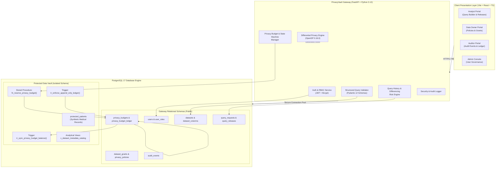
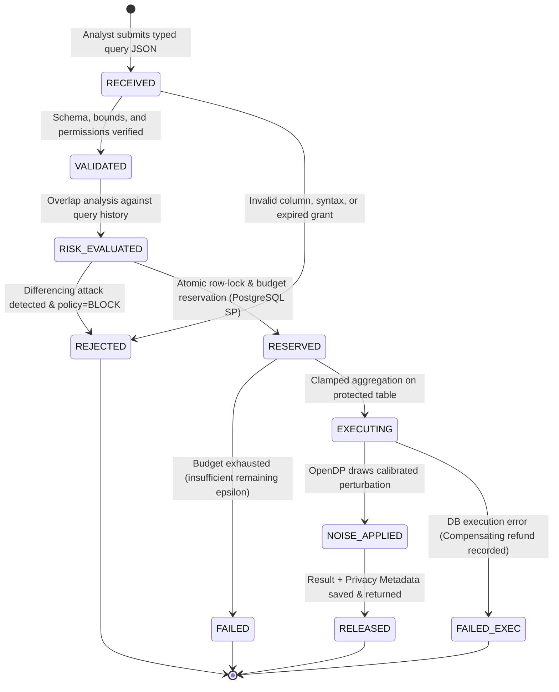

# PrivacyVault — System Architecture & Technical Design

**Document Version:** 1.0.0  
**Project:** PrivacyVault — An Explainable, Privacy-Preserving Database Analytics Gateway  
**Authors:** Student `24BCE0846` & `24BCE0870` (BCSE302P L25+L26)  

---

## 1. High-Level System Architecture

PrivacyVault employs a defense-in-depth, 3-tier architecture designed to separate analyst interactions from sensitive underlying relational storage:



---

## 2. Key Architectural Subsystems

### 2.1 Presentation Tier (React + TypeScript + Vite)
- **Component System:** Accessible, responsive UI with glassmorphic accents, dark theme, interactive charts, and real-time budget depletion gauges.
- **Role-Aware Dashboards:**
  - *Analyst:* Interactive Aggregate Builder (Dataset selector, approved aggregations, column picker, range filters, epsilon slider), Live Results table with noise badges, Differencing Risk Explanations.
  - *Data Owner:* Dataset registration, privacy policy tuning ($\epsilon_{max}$, sensitivity clamping limits), analyst grant issuance.
  - *Auditor:* Filterable security log, full query decision history, immutable budget ledger inspector.
  - *Admin:* User account creation, role assignments, system health telemetry.

### 2.2 Application Gateway Tier (FastAPI)
- **Zero Raw-SQL Policy:** Clients submit typed JSON query descriptors (`AggregateQueryRequest`). The gateway uses SQLAlchemy 2.0 query constructors; raw SQL string concatenation from user inputs is strictly impossible.
- **OpenDP Core Engine:** Integrates official `opendp` 0.16.0 library:
  - Bounded sensitivity clamping before aggregation.
  - Pure $\epsilon$-Differential Privacy via Laplace mechanism.
  - Approximate $(\epsilon, \delta)$-Differential Privacy via Gaussian mechanism.
- **Explainable Risk Engine:**
  - Performs multi-query overlap analysis over past released queries within the active budget window.
  - Detects differencing attacks ($Q_1 \setminus Q_2 = \{ \text{individual} \}$).
  - Warns or blocks reconstruction attempts before budget is permanently debited.

### 2.3 PostgreSQL Database Tier
- **Dual Database Roles:**
  1. `privacyvault_migrator`: Table owner used solely for running Alembic migrations and administrative initialization.
  2. `privacyvault_app`: Restricted runtime role used by the FastAPI connection pool. Lacks table-drop privileges and has granular table grants.
- **Database-Enforced Integrity:**
  - Stored Procedure `fn_reserve_privacy_budget`: Row-level atomic reservation using `SELECT ... FOR UPDATE` with explicit transaction rollback on balance violation.
  - Database Trigger `tr_enforce_append_only_ledger`: Prevents `UPDATE` and `DELETE` on `privacy_budget_ledger`.
  - Database Trigger `tr_sync_privacy_budget_balance`: Validates ledger sum matches `privacy_budgets.remaining_epsilon`.
  - Check Constraints: Ensures non-negative remaining budget, valid privacy parameters ($\epsilon > 0$).

---

## 3. Query Processing State Machine

The gateway enforces an atomic 5-state lifecycle for every submitted analytics request:



---

## 4. Transactional Correctness & Concurrency Model

A critical vulnerability in naive differential privacy gateways is **budget race conditions**: two concurrent threads read `remaining_budget = 0.8`, both deduct `0.5`, and both release results, spending $1.0$ total against a limit of $0.8$.

PrivacyVault eliminates this flaw through a PostgreSQL stored procedure:

```sql
CREATE OR REPLACE FUNCTION fn_reserve_privacy_budget(
    p_budget_id UUID,
    p_requested_epsilon NUMERIC,
    p_request_id UUID
)
RETURNS TABLE (
    success BOOLEAN,
    remaining NUMERIC,
    error_message TEXT
) 
LANGUAGE plpgsql
SECURITY DEFINER
SET search_path = public, pg_temp
AS $$
DECLARE
    v_current_remaining NUMERIC;
BEGIN
    -- Acquire exclusive row-level lock on the target budget record
    SELECT remaining_epsilon 
    INTO v_current_remaining
    FROM privacy_budgets
    WHERE id = p_budget_id
    FOR UPDATE;

    IF NOT FOUND THEN
        RETURN QUERY SELECT FALSE, 0.0::NUMERIC, 'Budget record not found'::TEXT;
        RETURN;
    END IF;

    IF v_current_remaining < p_requested_epsilon THEN
        RETURN QUERY SELECT FALSE, v_current_remaining, 'Insufficient privacy budget remaining'::TEXT;
        RETURN;
    END IF;

    -- Debit budget atomically
    UPDATE privacy_budgets
    SET remaining_epsilon = remaining_epsilon - p_requested_epsilon,
        updated_at = NOW()
    WHERE id = p_budget_id;

    -- Create reservation ledger entry
    INSERT INTO privacy_budget_ledger (
        id, budget_id, request_id, amount, transaction_type, balance_after, created_at
    ) VALUES (
        gen_random_uuid(), p_budget_id, p_request_id, p_requested_epsilon, 'RESERVATION', 
        v_current_remaining - p_requested_epsilon, NOW()
    );

    RETURN QUERY SELECT TRUE, (v_current_remaining - p_requested_epsilon), NULL::TEXT;
END;
$$;
```

If downstream computation fails, a compensating refund transaction (`transaction_type = 'REFUND'`) replenishes the balance via the same atomic lock pattern.
