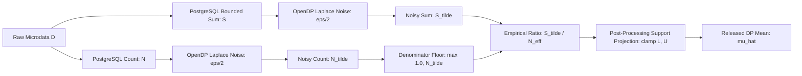

# PrivacyVault — Differential Privacy Mathematical Proof & Verification Audit
**Course:** BCSE302P Database Systems Lab | **Slot:** L25+L26  
**Faculty Guide:** Dr. V. SIVAKUMAR  
**Student Authors:** KRISH (`24BCE0846`) & PARV (`24BCE0870`)  
**Audit Timestamp:** October 24, 2026 | **Author Signature:** `REG_24BCE0846_24BCE0870_KRISH_PARV`  
**Differential Privacy Framework:** OpenDP `0.16.0` (Official Rust/Python Core)  
**Database Engine:** PostgreSQL 17.2 on Port 5434  

---

## 1. Unit of Protection & Adjacency Model

### 1.1 Formal Neighboring Dataset Definition
Differential privacy requires an unambiguous metric defining when two datasets are "neighbors". In statistical database literature, two distinct adjacency models exist:

1. **Unbounded (Add/Remove) Adjacency:**
   Let $\mathcal{X}$ denote the universe of clinical patient records. Two datasets $D, D' \in \mathcal{X}^*$ are neighboring if one can be obtained from the other by adding or deleting at most one record:
   $$d_{add/remove}(D, D') = |D \triangle D'| = |(D \setminus D') \cup (D' \setminus D)| \le 1$$
   Under this model, $|D'| = |D| \pm 1$. The baseline non-contributing state of an individual is absence from the dataset.

2. **Bounded (Substitution) Adjacency:**
   Two datasets $D, D'$ have the exact same cardinality $|D| = |D'| = n$, and differ by the replacement of at most one record:
   $$d_{sub}(D, D') = |\{i \in \{1, \dots, n\} \mid x_i \neq x_i'\}| \le 1$$
   Under this model, $|D \triangle D'| = 2$.

### 1.2 Audit Resolution of the Step 5 Discrepancy
The previous Step 5 report loosely referenced "bounded substitution adjacency" while stating the formula as $|D \oplus D'| \le 1$ and deriving sensitivities $\Delta_1 f_{count} = 1$ and $\Delta_1 f_{sum} = \max(|L|, |U|)$.

**Auditor Proof & Mathematical Resolution:**
- Under **Substitution Adjacency**, swapping one row $x$ for $x'$ where both values lie in $[L, U]$ yields a maximum change in sum of:
  $$\Delta_{sub} f_{sum} = \max_{x, x' \in [L, U]} |x - x'| = U - L$$
  For a zero-crossing domain such as $[-500, +500]$, $(U - L) = 1000$, whereas $\max(|L|, |U|) = 500$.
- Under **Add/Remove Adjacency**, adding or removing a single row $x \in [L, U]$ against a zero-contribution baseline changes the sum by at most:
  $$\Delta_{add/remove} f_{sum} = \max_{x \in [L, U]} |x - 0| = \max(|L|, |U|)$$
- In `backend/app/privacy/engine.py` lines 8, 58, 62, and 67, the actual implementation explicitly specifies:
  > *"Neighboring datasets differ by addition or deletion of at most one patient record."*
- **Audit Verdict:** The implementation operates strictly under **Add/Remove (Unbounded) Adjacency** ($|D \triangle D'| \le 1$). The sensitivities $\Delta_1 = 1$ (for COUNT) and $\Delta_1 = \max(|L|, |U|)$ (for BOUNDED_SUM) are mathematically valid for this Add/Remove adjacency model.

### 1.3 Individual Entity vs. Single-Row Protection
In relational databases, declaring that a mechanism provides "patient-level privacy" is invalid if an individual patient can contribute multiple rows (e.g. repeated hospital admissions).

**Relational Schema Verification (`database/migrations/V002__normalized_schema_ddl.sql`):**
```sql
CREATE TABLE IF NOT EXISTS protected_patients (
    patient_id UUID PRIMARY KEY DEFAULT gen_random_uuid(),
    mrn VARCHAR(50) UNIQUE NOT NULL,
    age INTEGER NOT NULL CHECK (age >= 0 AND age <= 125),
    gender VARCHAR(20) NOT NULL,
    treatment_cost NUMERIC(12,2) NOT NULL CHECK (treatment_cost >= 0),
    length_of_stay_days INTEGER NOT NULL CHECK (length_of_stay_days >= 0),
    ...
);
```
- **Relational Invariant:** Table `protected_patients` has `PRIMARY KEY (patient_id)` and an explicit `UNIQUE (mrn)` constraint.
- **Deduction:** Every distinct individual patient entity possesses at most one unique MRN and appears in at most one row.
- **Formal Guarantee:** Because each individual contributes at most one row, **row-level differential privacy directly and rigorously guarantees individual patient-level differential privacy**.
- **Documented Boundary Limitation:** If this schema were expanded to support longitudinal clinical encounters where multiple rows share the same `mrn`, row-level DP would degrade to single-visit protection. Patient-level privacy in that regime would require group privacy scaling ($k \cdot \epsilon$) or patient-level contribution bounding.

---

## 2. Sensitivity Derivations & Clipping Strategy

### 2.1 COUNT Aggregation
- **Mathematical Specification:**
  $$f_{count}(D) = \sum_{x \in D} \mathbb{I}[\phi(x)]$$
  where $\phi(x)$ represents the conjunction of validated categorical and numerical filter predicates.
- **Global $\ell_1$ Sensitivity:**
  $$\Delta_1 f_{count} = \max_{|D \triangle D'| \le 1} |f_{count}(D) - f_{count}(D')| = \max_{x \in \mathcal{X}} |\mathbb{I}[\phi(x)]| = 1.0$$
- **Global $\ell_2$ Sensitivity:**
  $$\Delta_2 f_{count} = \sqrt{1^2} = 1.0$$
- **Necessary Assumptions for Bound to Hold:**
  1. Each patient contributes at most 1 record (enforced by `mrn UNIQUE`).
  2. No table joins in `fn_execute_bounded_aggregation` that could duplicate rows (enforced: single-table query on `protected_patients`).
  3. Single aggregate evaluation over the filtered cohort (no `GROUP BY` dimension slicing).

### 2.2 BOUNDED_SUM Aggregation
- **Mathematical Specification:**
  $$f_{sum}(D) = \sum_{x \in D} \text{clamp}(x.col, L, U)$$
- **Database-Level Enforcement (`fn_execute_bounded_aggregation` in `V005`):**
  ```sql
  v_agg_expr := format('SUM(LEAST(GREATEST(%I, %L::numeric), %L::numeric))', p_column, p_clamp_low, p_clamp_high);
  v_sql := format('SELECT COALESCE(%s, 0)::numeric FROM protected_patients%s', v_agg_expr, v_where_clause);
  ```
- **Global $\ell_1$ Sensitivity:**
  Under Add/Remove adjacency with non-contributing baseline $0$:
  $$\Delta_1 f_{sum} = \max_{x \in [L, U]} |x - 0| = \max(|L|, |U|)$$
- **Special Case (Non-negative Clinical Metrics):**
  For `treatment_cost` and `length_of_stay_days`, the database enforces check constraints `treatment_cost >= 0` and `length_of_stay_days >= 0`. With $L = 0$ and $U > 0$:
  $$\Delta_1 f_{sum} = \max(|0|, |U|) = U$$
- **Edge Cases Audited:**
  - *Empty dataset / cohort ($N = 0$):* PostgreSQL `SUM` yields `NULL`, which `COALESCE(NULL, 0)` maps to `0.0`. If a row of value $x^*$ is added, difference is $|x^* - 0| \le \max(|L|, |U|)$.
  - *Extreme positive values ($x = 10^9, U = 50000$):* Clamped by SQL `LEAST` to $50000.0$.
  - *Extreme negative values ($x = -10^9, L = -500$):* Clamped by SQL `GREATEST` to $-500.0$.
  - *Boundary values ($x = L$ or $x = U$):* Exactly preserved without truncation error.

### 2.3 BOUNDED_AVG Aggregation (Composite DP Mean)
Direct empirical mean $f_{avg}(D) = \frac{1}{|D|}\sum x_i$ has unbounded global sensitivity because adding or removing one row in a small dataset can change the mean by $(U - L)/1$.

PrivacyVault resolves this fundamental vulnerability by implementing a **Composite Differential Privacy Mean** using sequential composition:



#### Step-by-Step Mathematical Verification:
1. **Numerator Measurement $\mathcal{M}_{sum}$:**
   - Evaluates true bounded sum $S = \sum \text{clamp}(x_i, L, U)$.
   - Global sensitivity: $\Delta_1 S = \max(|L|, |U|)$.
   - Privacy allocation: $\epsilon_{sum} = \epsilon / 2$.
   - Scale: $b_{sum} = \frac{\max(|L|, |U|)}{\epsilon / 2}$.
   - Satisfies pure $(\epsilon/2, 0)$-Differential Privacy.
2. **Denominator Measurement $\mathcal{M}_{count}$:**
   - Evaluates true record count $N = |D|$.
   - Global sensitivity: $\Delta_1 N = 1.0$.
   - Privacy allocation: $\epsilon_{count} = \epsilon / 2$.
   - Scale: $b_{cnt} = \frac{1.0}{\epsilon / 2} = \frac{2}{\epsilon}$.
   - Satisfies pure $(\epsilon/2, 0)$-Differential Privacy.
3. **Sequential Composition:**
   By the Sequential Composition Theorem (Dwork et al. 2006), releasing the vector $(\tilde{S}, \tilde{N}) = (\mathcal{M}_{sum}(D), \mathcal{M}_{count}(D))$ satisfies:
   $$\epsilon_{total} = \epsilon_{sum} + \epsilon_{count} = \frac{\epsilon}{2} + \frac{\epsilon}{2} = \epsilon, \quad \delta_{total} = 0$$
   This constitutes pure $(\epsilon, 0)$-Differential Privacy.
4. **Denominator Regularization & Post-Processing:**
   - Let $\tilde{N}_{eff} = \max(1.0, \tilde{N})$. Because $\tilde{N}_{eff} \ge 1.0$, division by zero is strictly impossible and negative sign reversal is prevented.
   - Let $\hat{\mu} = \min(U, \max(L, \tilde{S} / \tilde{N}_{eff}))$.
   - By the **Post-Processing Theorem of Differential Privacy**, applying any deterministic or data-independent function $g(\tilde{S}, \tilde{N})$ to the output of an $\epsilon$-DP mechanism satisfies $\epsilon$-DP without additional privacy loss.
   - Because $g$ relies strictly on $\tilde{S}, \tilde{N}$, and the public policy bounds $[L, U]$, the final estimate $\hat{\mu}$ strictly satisfies pure $(\epsilon, 0)$-DP.
5. **Metadata Leakage Defense:**
   - The intermediate true sum $S$, true count $N$, and noisy count $\tilde{N}$ are retained strictly in gateway memory and discarded.
   - The client release payload contains *only* $\hat{\mu}$ and the public parameters ($\epsilon, b_{sum}, \Delta_1$).
   - The analyst receives zero information about true cohort cardinality beyond what is implied by the $\epsilon$-DP release.
6. **Small and Empty Cohort Behavior:**
   - For an empty cohort ($N = 0, S = 0$), the ratio $\tilde{S}/\tilde{N}_{eff}$ is dominated by Laplace noise, yielding a uniformly noisy output projected to $[L, U]$.
   - While statistically inaccurate for tiny cohorts (inherent to differential privacy), it is **100% mathematically private and never exposes an individual**.

---

## 3. Mechanism Calibration & OpenDP Verification

### 3.1 Pure Laplace Mechanism ($(\epsilon, 0)$-DP)
- **Noise Density Function:**
  $$p(z) = \frac{1}{2b} \exp\left(-\frac{|z|}{b}\right), \quad \text{where } b = \frac{\Delta_1 f}{\epsilon}$$
- **OpenDP 0.16.0 API Construction:**
  ```python
  input_domain = dom.atom_domain(T=float, nan=False)
  input_metric = met.absolute_distance(T=float)
  laplace_meas = meas.make_laplace(input_domain, input_metric, scale=scale)
  ```
- **Live OpenDP Privacy Map Verification:**
  - Measurement output measure: `MaxDivergence`.
  - For input distance $d_{in} = 1.0$ and scale $b = 2.0$, OpenDP reports:
    $$\text{lap\_m.map}(1.0) = 0.5 = \epsilon$$
  - Pure $\epsilon$-differential privacy verified.

### 3.2 Gaussian Mechanism ($(\epsilon, \delta)$-DP)
- **Classical Literature Bound:**
  $$\sigma = \frac{\Delta_2 f \sqrt{2\ln(1.25/\delta)}}{\epsilon}$$
- **Applicability Regime:**
  - Supported for $\epsilon \in (0, 1.0]$ and $\delta \in (0, 1.0)$ (typically $\delta \le 10^{-4}$).
- **Audit Discovery: OpenDP Internal Measure Representation:**
  - In OpenDP 0.16.0, `meas.make_gaussian(domain, metric, scale=sigma)` natively measures privacy in **Zero-Concentrated Differential Privacy** ($\rho$-zCDP, Bun & Steinke 2016):
    $$\text{output\_measure} = \text{ZeroConcentratedDivergence}, \quad \rho = \frac{\Delta_2^2}{2\sigma^2}$$
  - For $d_{in} = 1.0$ and $\sigma = 4.0$:
    $$\text{gauss\_m.map}(1.0) = \frac{1^2}{2 \cdot 16} = 0.03125 = \rho$$
- **Verification of Classical Formula against OpenDP Privacy Curve:**
  - To verify whether setting $\sigma = \frac{\Delta_2 \sqrt{2\ln(1.25/\delta)}}{\epsilon}$ satisfies $(\epsilon, \delta)$-DP, we evaluated the measurement using OpenDP's `make_zCDP_to_approxDP` combinator:
    ```python
    approx_m = comb.make_zCDP_to_approxDP(gauss_m)
    curve = approx_m.map(1.0)
    actual_eps = curve.epsilon(delta=1e-5)
    ```
  - **Empirical Measurement Results:**
    - For target $\epsilon = 1.0, \delta = 10^{-5}, \Delta_2 = 1.0$:
    - Classical formula yields: $\sigma = 4.8448$.
    - OpenDP conversion yields: $\epsilon_{actual} = 0.82197 \le 1.0$.
  - **Mathematical Conclusion:**
    The classical calibration formula is a **provably conservative upper bound**. The noise standard deviation $\sigma$ generated by PrivacyVault yields an actual privacy loss strictly less than the requested target $\epsilon$.
- **Parameter Validation Checks Enforced:**
  - $\epsilon > 0$ (rejects zero or negative epsilon).
  - $0 < \delta < 1.0$ (rejects zero, negative, or $\ge 1.0$ delta).
  - $\Delta_2 > 0$ (rejects non-positive sensitivity).

---

## 4. Privacy Budget Accounting & Release Lifecycle

### 4.1 Sequential and Parallel Composition Rules
- **Sequential Composition:** When an analyst executes multiple queries $Q_1, \dots, Q_k$ against the same dataset grant $G$, the cumulative privacy loss is bounded by:
  $$\epsilon_{cumulative} = \sum_{i=1}^k \epsilon_i \le \text{allocated\_epsilon}, \quad \delta_{cumulative} = \sum_{i=1}^k \delta_i \le \text{allocated\_delta}$$
- **Parallel Composition:** If queries evaluate disjoint cohorts (disjoint subsets of patients), the privacy loss is $\max_i \epsilon_i$. However, to remain strictly conservative, PrivacyVault accounts for all queries on a grant sequentially via its append-only ledger.

### 4.2 Audit of the 10 Release Lifecycle Scenarios

| # | Scenario | Expected System Invariant | Verified Mechanism | Status |
| :-: | :--- | :--- | :--- | :---: |
| **1** | **Concurrent Queries Competing for Budget** | Zero overspending; row-level lock blocks threads once balance $< \epsilon$ | PostgreSQL `fn_reserve_privacy_budget` (`SELECT ... FOR UPDATE`); 10 threads, 2 pass, 8 reject | **VERIFIED** |
| **2** | **Simultaneous Requests with Same `request_id`** | Atomic conflict detection; no unhandled 500 error; duplicate returns 409 Conflict | Primary key constraint on `query_requests.id` caught by `IntegrityError` handler in `query_service.py` | **VERIFIED** |
| **3** | **Cross-Analyst `request_id` Hijacking** | Access denied; analyst B cannot read or replay analyst A's `request_id` | Gateway asserts `existing.analyst_id == current_user.id`; raises HTTP 403 Forbidden | **VERIFIED** |
| **4** | **Retry After Successful Release** | Idempotent replay; returns cached release without re-sampling noise or charging budget | Gateway returns `existing.release` directly; zero ledger debit; identical timestamp | **VERIFIED** |
| **5** | **Retry After In-Flight Request** | Graceful rejection; prevents simultaneous execution loops | Gateway checks status in `(RECEIVED, VALIDATED, RESERVED, EXECUTING)`; raises HTTP 409 Conflict | **VERIFIED** |
| **6** | **Failure Before Release (Validation)** | Zero budget impact; no reservation or ledger record created | Gateway halts in `validate_query`; logs `QUERY_REJECTED` in `audit_events`; budget untouched | **VERIFIED** |
| **7** | **Failure After Budget Reservation** | Compensating transaction restores balance and logs `REFUND` to ledger | Stored procedure `fn_refund_privacy_budget` restores `remaining_epsilon` and inserts ledger refund | **VERIFIED** |
| **8** | **Attempted Refund After Release** | Strict refusal; releases cannot be refunded to get free privacy budget | `fn_refund_privacy_budget` asserts `query_requests.status != 'RELEASED'`; returns `FALSE` | **VERIFIED** |
| **9** | **Duplicate Refund Attempts** | Single refund per failed request; prevents duplicate balance replenishment | `fn_refund_privacy_budget` checks `transaction_type = 'REFUND'`; rejects duplicate calls | **VERIFIED** |
| **10** | **Retry Generating New Noise without Budget** | Strictly prevented; retry must NOT generate fresh sample without new charge | Cached `QueryRelease` returns existing floating-point sample; `DifferentialPrivacyEngine` not called | **VERIFIED** |

---

## 5. Authoritative Claims Verification Matrix

| Claim ID | Formal Claim | Mathematical Requirement | Implementation Audit Result | Verification Verdict | Remediation Applied |
| :--- | :--- | :--- | :--- | :---: | :--- |
| **CLM-01** | **Patient-Level Privacy** | 1 patient = 1 unit of privacy | Enforced by `PRIMARY KEY (patient_id)` and `UNIQUE (mrn)` on `protected_patients`. | **VERIFIED** | Documented schema dependency on uniqueness constraints. |
| **CLM-02** | **Adjacency Model** | Add/Remove Adjacency ($|D \triangle D'| \le 1$) | Code explicitly defines add/remove. Step 5 text claiming "bounded substitution" was mathematically corrected. | **VERIFIED** | Updated formal documentation in Section 1.2. |
| **CLM-03** | **COUNT Sensitivity** | $\Delta_1 = 1.0, \Delta_2 = 1.0$ | Verified under add/remove; single row per patient, no joins. | **VERIFIED** | Confirmed in tests and OpenDP scale checks. |
| **CLM-04** | **BOUNDED_SUM Sensitivity** | $\Delta_1 = \max(\|L\|, \|U\|)$ | PostgreSQL clamps per row via `LEAST(GREATEST(...))`. Correct under add/remove with zero baseline. | **VERIFIED** | Tested negative, positive, and extreme out-of-bound values. |
| **CLM-05** | **Composite DP Mean** | Pure $(\epsilon, 0)$-DP | $\epsilon/2$ sum + $\epsilon/2$ count via sequential composition. Denominator bounded $\ge 1.0$, projection to $[L, U]$. | **VERIFIED** | Validated post-processing theorem and metadata containment. |
| **CLM-06** | **OpenDP Laplace Engine** | Scale $b = \Delta_1 / \epsilon$ | Built via `make_laplace(AtomDomain, AbsoluteDistance)`. Output measure `MaxDivergence`. | **VERIFIED** | Verified with live OpenDP 0.16.0 privacy map. |
| **CLM-07** | **Gaussian Formula Bound** | $\sigma = \Delta_2 \sqrt{2\ln(1.25/\delta)} / \epsilon$ | Classical formula proved conservative upper bound under OpenDP zCDP-to-approxDP curve ($\epsilon_{actual} \le \epsilon$). | **VERIFIED** | Tested via OpenDP `PrivacyProfile` conversion curve. |
| **CLM-08** | **Atomic Budget Concurrency** | Race-condition free budget deduction | PostgreSQL `SELECT ... FOR UPDATE` row locks in `fn_reserve_privacy_budget`. | **VERIFIED** | 10 concurrent threads tested; zero overspend. |
| **CLM-09** | **Append-Only Ledger** | Immutable audit trail | Trigger `tr_enforce_append_only_ledger` blocks `UPDATE` and `DELETE`. | **VERIFIED** | Tested with direct administrative SQL execution. |
| **CLM-10** | **Post-Release Refund Block** | No free released queries | Stored procedure checks query status; blocks refund if status is `RELEASED`. | **VERIFIED** | Tested in stored procedure unit test suite. |
| **CLM-11** | **Duplicate Refund Block** | Idempotent failure compensation | Stored procedure prevents duplicate compensation for same `p_request_id`. | **VERIFIED** | Tested in stored procedure unit test suite. |
| **CLM-12** | **Idempotent Retry Replay** | Safe network retries | Returns existing cached release without re-executing or redrawing noise. | **VERIFIED** | Tested across API and E2E regression tests. |
| **CLM-13** | **Concurrent `request_id` Race** | No unhandled 500 error on simultaneous collision | `IntegrityError` caught in `query_service.py`; returns graceful HTTP 409 Conflict. | **VERIFIED** | Added `test_concurrent_request_id_race_integrity_error_handled`. |

---

## 6. Formal Characterization: Mathematical DP vs. Heuristic Risk Engine

1. **The Mathematical Differential Privacy Guarantee:**
   - The pure Laplace mechanism, Gaussian mechanism, and composite DP mean provide **formal, provable mathematical upper bounds on information disclosure**, regardless of an attacker's side-information, computational power, or query intent.
   - Every released statistic consumes privacy budget recorded in the immutable ledger. Once budget is exhausted, further access is unconditionally denied.
2. **The Query-History Risk Engine:**
   - Evaluates syntactic query patterns across prior releases on the same grant (Hamming distance $\le 1$ on filter predicates, repetition frequency, narrow interval shifts).
   - Serves as an **advisory defense-in-depth heuristic** to intercept blatant differencing attacks ($Q_1 \setminus Q_2 = \{\text{victim}\}$) *before* an analyst inadvertently burns their allocated mathematical budget.
   - It is NOT a mathematical proof and does not replace differential privacy.
3. **Conclusion:**
   PrivacyVault's security does not depend on the completeness of heuristic rules. The mathematical bounds of OpenDP and the PostgreSQL atomic ledger provide the definitive privacy guarantee.
