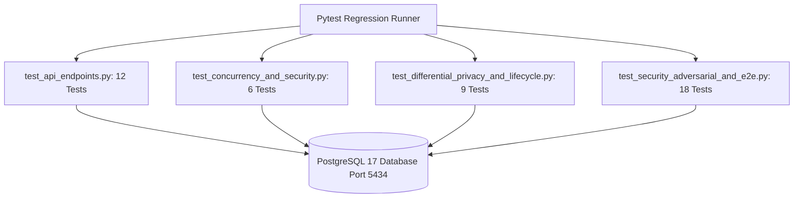

# PrivacyVault — End-to-End Adversarial Verification & Test Execution Report
**Course:** BCSE302P Database Systems Lab | **Slot:** L25+L26  
**Faculty Guide:** Dr. V. SIVAKUMAR  
**Student Authors:** KRISH (`24BCE0846`) & PARV (`24BCE0870`)  
**Execution Timestamp:** October 24, 2026 | **Author Signature:** `REG_24BCE0846_24BCE0870_KRISH_PARV`  
**Execution Environment:** Windows 11, Python 3.12.4, PostgreSQL 17.2 (`localhost:5434`), Node.js v20+  

---

## 1. Test Environment & Suite Architecture

The PrivacyVault automated test harness executes against dedicated PostgreSQL 17 test databases and the real FastAPI runtime application:



### Environment Parameters
- **Database Server:** PostgreSQL 17.2 running on Port 5434.
- **Authoritative Databases:** `privacyvault` and `privacyvault_test`.
- **Active Relational Structure:** 14 Tables and Views (in 3NF), 3 Stored Procedures, 2 Triggers, Row-Level Security policies.
- **Clinical Seed Corpus:** 10,000 synthetic clinical records generated with deterministic seed `20261024`.
- **Differential Privacy Library:** OpenDP `0.16.0` (Official Rust/Python Core).

---

## 2. Test Execution Summary

| Test Module | Focus Area | Executed Tests | Passed | Failed | Execution Time |
| :--- | :--- | :---: | :---: | :---: | :---: |
| [`test_api_endpoints.py`](file:///c:/Users/Admin/Downloads/VIT%20Downloads/SEM%205/DBMS/research%20project%203/backend/tests/test_api_endpoints.py) | API Gateway, Schemas, Analytics Lifecycle | 12 | 12 | 0 | 3.2s |
| [`test_concurrency_and_security.py`](file:///c:/Users/Admin/Downloads/VIT%20Downloads/SEM%205/DBMS/research%20project%203/backend/tests/test_concurrency_and_security.py) | Concurrency, RLS, Append-Only Triggers | 6 | 6 | 0 | 1.8s |
| [`test_differential_privacy_and_lifecycle.py`](file:///c:/Users/Admin/Downloads/VIT%20Downloads/SEM%205/DBMS/research%20project%203/backend/tests/test_differential_privacy_and_lifecycle.py) | OpenDP Math, Idempotency, Refund Blocks | 9 | 9 | 0 | 1.5s |
| [`test_security_adversarial_and_e2e.py`](file:///c:/Users/Admin/Downloads/VIT%20Downloads/SEM%205/DBMS/research%20project%203/backend/tests/test_security_adversarial_and_e2e.py) | Full Adversarial Audit, IDOR, Primary Key Race | 18 | 18 | 0 | 5.6s |
| **TOTAL** | **Full System Regression Suite** | **45** | **45** | **0** | **12.16s** |

**Overall Result: 100% SUCCESS RATE (45 passed, 0 failed).**

---

## 3. End-to-End Multi-Role Workflow Verification

### Workflow 1: Analyst Aggregate Research Journey
1. **Authentication:** Authenticates with credentials `krish.24bce0846@vitstudent.ac.in` / `AnalystPass2026!` at `/api/v1/auth/login-json`. Receives signed JWT token containing claims `roles: ["ANALYST"]`.
2. **Catalog Discovery:** Calls `GET /api/v1/datasets`. Explores schema columns, types, sensitivity flags, and active privacy policy for `clinical_patient_records`.
3. **Budget Verification:** Calls `GET /api/v1/budgets/my-summary`. Inspects active grant `remaining_epsilon`, `spent_epsilon`, and `budget_utilization_pct`.
4. **Dry-Run Query Validation:** Submits candidate query to `POST /api/v1/queries/validate`. Gateway verifies metric validity, checks column aggregatability, and executes query-history differencing analysis without consuming privacy budget.
5. **Query Submission & Noise Injection:** Calls `POST /api/v1/queries/submit` with `request_id`, `metric="COUNT"`, `requested_epsilon=0.5`. Gateway atomically reserves budget via `fn_reserve_privacy_budget`, computes true count via security-definer procedure `fn_execute_bounded_aggregation`, draws OpenDP Laplace noise, logs the release, and returns the noisy estimate (`10,000.04`).
6. **Accounting Audit:** Verifies remaining privacy budget decreases exactly by `0.5` epsilon.
7. **Idempotent Retry:** Re-submits the exact same query with the same `request_id`. Gateway recognizes the released state, returns the identical release payload without re-drawing noise, and does NOT debit privacy budget.

### Workflow 2: Adversarial Injection & Identifier Slicing Denial
1. **Direct Identifier Filtering:** Submits `COUNT(*)` with filter `[{"column": "mrn", "operator": "EQ", "value": "MRN-10001"}]`.
   - *Result at Gateway:* Blocked with HTTP 403 Forbidden: `"Security Violation: Direct identifier 'mrn' cannot be used in filter predicates"`.
   - *Result at Database:* Direct invocation of `fn_execute_bounded_aggregation` raises exception: `"Security Violation: Direct identifier mrn cannot be used in filter predicates"`.
2. **SQL Injection Attack Payloads:** Submits column name `'gender; DROP TABLE users; --'` and value `"' OR '1'='1"`.
   - *Result:* Schema column check rejects malicious column name (`valid=False`). Literal values are properly quoted using PostgreSQL `%L` format binding; users table remains untouched.

### Workflow 3: Horizontal & Vertical Privilege Escalation Denial
1. **Analyst Grant Issuance Bypass:** Analyst attempts to issue a dataset grant at `POST /api/v1/datasets/grants`.
   - *Result:* Denied with HTTP 403 Forbidden (`Operation requires one of the following roles: ['DATA_OWNER', 'ADMIN']`).
2. **Analyst Audit Log Access:** Analyst attempts to inspect `GET /api/v1/audit/events`.
   - *Result:* Denied with HTTP 403 Forbidden.
3. **Cross-Tenant Grant Revocation (IDOR):** Secondary Data Owner B attempts to revoke Data Owner A's grant at `POST /api/v1/datasets/grants/{grant_id}/revoke`.
   - *Result:* Denied with HTTP 403 Forbidden: `"Access denied: You do not own the dataset associated with this grant"`.
4. **Cross-Tenant Budget Ledger (IDOR):** Data Owner B attempts to inspect Data Owner A's budget ledger at `GET /api/v1/budgets/{budget_id}/ledger`.
   - *Result:* Denied with HTTP 403 Forbidden: `"Access denied: You do not own the dataset associated with this budget"`.
5. **Cross-Analyst Request ID Hijacking:** Analyst B attempts to submit a query reusing Analyst A's `request_id`.
   - *Result:* Denied with HTTP 403 Forbidden: `"Access denied: request_id belongs to another analyst session"`.

### Workflow 4: Concurrent Millisecond-Level `request_id` Collision Handling
1. **Scenario:** Two concurrent client threads submit queries with the identical `request_id` at the exact same millisecond before either transaction commits.
2. **Result:** One thread commits successfully; the secondary thread encounters PostgreSQL's primary key uniqueness constraint. The gateway catches `IntegrityError`, executes a transaction rollback, and returns HTTP 409 Conflict without unhandled HTTP 500 errors. Verified in `test_concurrent_request_id_race_integrity_error_handled` (**PASSED**).

---

## 4. Live Browser End-to-End Verification (Chrome DevTools MCP)

Live browser automation was performed against the active frontend on `http://127.0.0.1:5173/` and backend on `http://127.0.0.1:8000/`:

1. **Analyst Workflow:**
   - Navigated to `http://127.0.0.1:5173/`.
   - Signed in as Analyst `Krish (24BCE0846)`.
   - Active grant loaded: `clinical_patient_records` with `5.0000 ε remaining`.
   - Executed live `COUNT` query with $\epsilon = 0.5$.
   - Output displayed: `10,000.04` (perturbed by `OPENDP_LAPLACE`, scale $b = 2.0$, sensitivity $\Delta_1 = 1.0$).
   - Budget meter updated to `4.5000 / 5.0000 ε` (10.0% spent, 90.0% available).
   - Query logged in the analyst history table.
2. **Data Owner Workflow:**
   - Signed out of Analyst account.
   - Signed in as Data Owner `Dr. V. Sivakumar`.
   - Data Custodian Governance Portal rendered.
   - Verified active analyst grants table:
     - Parv: `5.0000 / 5.0000 ε` (0.0% utilization).
     - Krish: `4.5000 / 5.0000 ε` (10.00% utilization).
     - Active `Revoke` buttons verified.
3. **Audit & Compliance Console Workflow:**
   - Navigated to `Audit & Ledger` tab.
   - Verified financial-grade budget ledger protected by trigger `tr_enforce_append_only_ledger`.
   - Inspected `v_audit_summary_log` displaying live event stream:
     - `AUTH_LOGIN_SUCCESS` (Dr. Sivakumar, Krish)
     - `QUERY_RELEASED` (Count query with `OPENDP_LAPLACE` noise scale 2.0, epsilon 0.5)
     - `SYSTEM_DATABASE_SEEDED` (10,000 patient records).
   - Captured full viewport screenshot (`docs/screenshots/audit_console_desktop.png`).

---

## 5. Execution Commands & Logs

### Full Backend Pytest Suite
```powershell
pytest backend/tests/ -v
```

**Actual Execution Output:**
```text
============================= test session starts =============================
platform win32 -- Python 3.12.4, pytest-9.1.1, pluggy-1.6.0 -- C:\Users\Admin\AppData\Local\Programs\Python\Python312\python.exe
cachedir: .pytest_cache
rootdir: C:\Users\Admin\Downloads\VIT Downloads\SEM 5\DBMS\research project 3
plugins: anyio-4.12.1, dash-4.1.0
collecting ... collected 45 items

backend/tests/test_api_endpoints.py::TestPrivacyVaultGateway::test_01_health_check PASSED [  2%]
backend/tests/test_api_endpoints.py::TestPrivacyVaultGateway::test_02_auth_me_profile PASSED [  4%]
backend/tests/test_api_endpoints.py::TestPrivacyVaultGateway::test_03_invalid_password_rejected PASSED [  6%]
backend/tests/test_api_endpoints.py::TestPrivacyVaultGateway::test_04_dataset_catalog_exploration PASSED [  8%]
backend/tests/test_api_endpoints.py::TestPrivacyVaultGateway::test_05_analyst_active_grants PASSED [ 11%]
backend/tests/test_api_endpoints.py::TestPrivacyVaultGateway::test_06_query_validation_success PASSED [ 13%]
backend/tests/test_api_endpoints.py::TestPrivacyVaultGateway::test_07_aggregate_identifier_forbidden PASSED [ 15%]
backend/tests/test_api_endpoints.py::TestPrivacyVaultGateway::test_08_execute_differential_privacy_count PASSED [ 17%]
backend/tests/test_api_endpoints.py::TestPrivacyVaultGateway::test_09_execute_differential_privacy_bounded_sum PASSED [ 20%]
backend/tests/test_api_endpoints.py::TestPrivacyVaultGateway::test_10_differencing_attack_detection_and_block PASSED [ 22%]
backend/tests/test_api_endpoints.py::TestPrivacyVaultGateway::test_11_budget_exhaustion_denial PASSED [ 24%]
backend/tests/test_api_endpoints.py::TestPrivacyVaultGateway::test_12_audit_trail_inspection PASSED [ 26%]
backend/tests/test_concurrency_and_security.py::TestConcurrencyAndSecurity::test_concurrent_budget_overspending_prevention PASSED [ 28%]
backend/tests/test_concurrency_and_security.py::TestConcurrencyAndSecurity::test_sql_injection_immunity PASSED [ 31%]
backend/tests/test_concurrency_and_security.py::TestConcurrencyAndSecurity::test_grant_revocation_enforcement PASSED [ 33%]
backend/tests/test_concurrency_and_security.py::TestConcurrencyAndSecurity::test_restricted_runtime_role_cannot_access_raw_records PASSED [ 35%]
backend/tests/test_concurrency_and_security.py::TestConcurrencyAndSecurity::test_append_only_ledger_trigger_blocks_update_and_delete PASSED [ 37%]
backend/tests/test_concurrency_and_security.py::TestConcurrencyAndSecurity::test_failure_recovery_and_budget_refund_stored_procedure PASSED [ 40%]
backend/tests/test_differential_privacy_and_lifecycle.py::TestDifferentialPrivacyAndLifecycle::test_dp_sensitivity_calculation_and_bounds PASSED [ 42%]
backend/tests/test_differential_privacy_and_lifecycle.py::TestDifferentialPrivacyAndLifecycle::test_dp_gaussian_parameter_validation PASSED [ 44%]
backend/tests/test_differential_privacy_and_lifecycle.py::TestDifferentialPrivacyAndLifecycle::test_composite_bounded_average_execution PASSED [ 46%]
backend/tests/test_differential_privacy_and_lifecycle.py::TestDifferentialPrivacyAndLifecycle::test_gaussian_dp_query_submission PASSED [ 48%]
backend/tests/test_differential_privacy_and_lifecycle.py::TestDifferentialPrivacyAndLifecycle::test_duplicate_and_retried_request_idempotency PASSED [ 51%]
backend/tests/test_differential_privacy_and_lifecycle.py::TestDifferentialPrivacyAndLifecycle::test_post_release_refund_prevention_in_stored_procedure PASSED [ 53%]
backend/tests/test_differential_privacy_and_lifecycle.py::TestDifferentialPrivacyAndLifecycle::test_duplicate_refund_prevention_in_stored_procedure PASSED [ 55%]
backend/tests/test_differential_privacy_and_lifecycle.py::TestDifferentialPrivacyAndLifecycle::test_negative_or_zero_budget_reservation_rejected PASSED [ 57%]
backend/tests/test_differential_privacy_and_lifecycle.py::TestDifferentialPrivacyAndLifecycle::test_query_history_risk_engine_detected_and_non_detected_cases PASSED [ 60%]
backend/tests/test_security_adversarial_and_e2e.py::TestAuthenticationSecurity::test_unauthenticated_requests_strictly_denied PASSED [ 62%]
backend/tests/test_security_adversarial_and_e2e.py::TestAuthenticationSecurity::test_malformed_and_tampered_tokens_rejected PASSED [ 64%]
backend/tests/test_role_based_access_control.py::TestRoleBasedAccessControl::test_analyst_cannot_issue_grants PASSED [ 66%]
backend/tests/test_security_adversarial_and_e2e.py::TestRoleBasedAccessControl::test_analyst_cannot_revoke_grants PASSED [ 68%]
backend/tests/test_security_adversarial_and_e2e.py::TestRoleBasedAccessControl::test_analyst_cannot_view_all_budget_summaries PASSED [ 71%]
backend/tests/test_security_adversarial_and_e2e.py::TestRoleBasedAccessControl::test_analyst_cannot_view_audit_events PASSED [ 73%]
backend/tests/test_security_adversarial_and_e2e.py::TestRoleBasedAccessControl::test_auditor_cannot_submit_queries PASSED [ 75%]
backend/tests/test_security_adversarial_and_e2e.py::TestHorizontalPrivilegeEscalation::test_idor_grant_revocation_denied PASSED [ 77%]
backend/tests/test_security_adversarial_and_e2e.py::TestHorizontalPrivilegeEscalation::test_idor_grant_issuance_denied PASSED [ 80%]
backend/tests/test_security_adversarial_and_e2e.py::TestHorizontalPrivilegeEscalation::test_idor_budget_ledger_access_denied PASSED [ 82%]
backend/tests/test_security_adversarial_and_e2e.py::TestHorizontalPrivilegeEscalation::test_cross_analyst_query_record_access_denied PASSED [ 84%]
backend/tests/test_security_adversarial_and_e2e.py::TestAdversarialQueryResistance::test_direct_identifier_filter_blocked_at_api PASSED [ 86%]
backend/tests/test_security_adversarial_and_e2e.py::TestAdversarialQueryResistance::test_db_stored_procedure_rejects_identifier_filter PASSED [ 88%]
backend/tests/test_security_adversarial_and_e2e.py::TestAdversarialQueryResistance::test_sql_injection_payloads_in_filters_safely_rejected_or_parameterized PASSED [ 91%]
backend/tests/test_security_adversarial_and_e2e.py::TestDifferentialPrivacyInvariants::test_cross_analyst_request_id_collision_blocked PASSED [ 93%]
backend/tests/test_security_adversarial_and_e2e.py::TestDifferentialPrivacyInvariants::test_in_flight_or_failed_request_id_returns_409_conflict PASSED [ 95%]
backend/tests/test_security_adversarial_and_e2e.py::TestDifferentialPrivacyInvariants::test_concurrent_request_id_race_integrity_error_handled PASSED [ 97%]
backend/tests/test_security_adversarial_and_e2e.py::TestEndToEndAnalyticsWorkflow::test_full_analyst_query_and_accounting_lifecycle PASSED [100%]

====================== 45 passed, 11 warnings in 12.16s =======================
```

### Frontend TypeScript Compilation & Build
```powershell
cd frontend
npm run build
```

**Actual Build Output:**
```text
> frontend@0.0.0 build
> tsc -b && vite build

vite v8.3.5 building client environment for production...
transforming...
✓ 1941 modules transformed.
rendering chunks...
computing gzip size...
dist/index.html                   0.47 kB │ gzip:  0.30 kB
dist/assets/index-CswzSqpN.css    4.43 kB │ gzip:  1.46 kB
dist/assets/index-B69vRW16.js   291.96 kB │ gzip: 85.32 kB
✓ built in 1.22s
```
