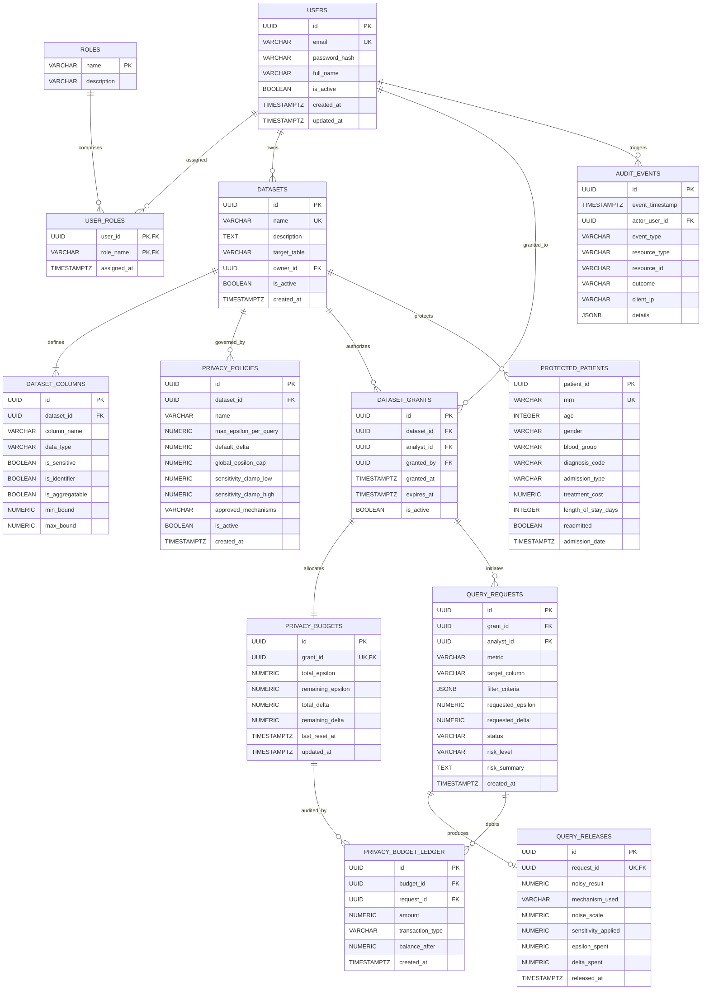

# PrivacyVault — Entity-Relationship (ER) Diagram & Relational Schema

**Document Version:** 1.0.0  
**Authors:** Student `24BCE0846` & `24BCE0870` (BCSE302P L25+L26)  
**Normalization Target:** Third Normal Form (3NF)  

---

## 1. Entity-Relationship (ER) Diagram (Crow's Foot Notation)

---

## 2. Relational Schema & Mathematical Relational Notation

1. $\text{USERS}(\underline{\text{id}}, \text{email}, \text{password\_hash}, \text{full\_name}, \text{is\_active}, \text{created\_at}, \text{updated\_at})$
2. $\text{ROLES}(\underline{\text{name}}, \text{description})$
3. $\text{USER\_ROLES}(\underline{\text{user\_id}}, \underline{\text{role\_name}}, \text{assigned\_at})$  
   *FK: $\text{user\_id} \to \text{USERS}(\text{id})$, $\text{role\_name} \to \text{ROLES}(\text{name})$*
4. $\text{DATASETS}(\underline{\text{id}}, \text{name}, \text{description}, \text{target\_table}, \text{owner\_id}, \text{is\_active}, \text{created\_at})$  
   *FK: $\text{owner\_id} \to \text{USERS}(\text{id})$*
5. $\text{DATASET\_COLUMNS}(\underline{\text{id}}, \text{dataset\_id}, \text{column\_name}, \text{data\_type}, \text{is\_sensitive}, \text{is\_identifier}, \text{is\_aggregatable}, \text{min\_bound}, \text{max\_bound})$  
   *FK: $\text{dataset\_id} \to \text{DATASETS}(\text{id})$*
6. $\text{PRIVACY\_POLICIES}(\underline{\text{id}}, \text{dataset\_id}, \text{name}, \text{max\_epsilon\_per\_query}, \text{default\_delta}, \text{global\_epsilon\_cap}, \text{sensitivity\_clamp\_low}, \text{sensitivity\_clamp\_high}, \text{approved\_mechanisms}, \text{is\_active}, \text{created\_at})$  
   *FK: $\text{dataset\_id} \to \text{DATASETS}(\text{id})$*
7. $\text{DATASET\_GRANTS}(\underline{\text{id}}, \text{dataset\_id}, \text{analyst\_id}, \text{granted\_by}, \text{granted\_at}, \text{expires\_at}, \text{is\_active})$  
   *FK: $\text{dataset\_id} \to \text{DATASETS}(\text{id})$, $\text{analyst\_id} \to \text{USERS}(\text{id})$, $\text{granted\_by} \to \text{USERS}(\text{id})$*
8. $\text{PRIVACY\_BUDGETS}(\underline{\text{id}}, \text{grant\_id}, \text{total\_epsilon}, \text{remaining\_epsilon}, \text{total\_delta}, \text{remaining\_delta}, \text{last\_reset\_at}, \text{updated\_at})$  
   *FK: $\text{grant\_id} \to \text{DATASET\_GRANTS}(\text{id})$*
9. $\text{PRIVACY\_BUDGET\_LEDGER}(\underline{\text{id}}, \text{budget\_id}, \text{request\_id}, \text{amount}, \text{transaction\_type}, \text{balance\_after}, \text{created\_at})$  
   *FK: $\text{budget\_id} \to \text{PRIVACY\_BUDGETS}(\text{id})$, $\text{request\_id} \to \text{QUERY\_REQUESTS}(\text{id})$*
10. $\text{QUERY\_REQUESTS}(\underline{\text{id}}, \text{grant\_id}, \text{analyst\_id}, \text{metric}, \text{target\_column}, \text{filter\_criteria}, \text{requested\_epsilon}, \text{requested\_delta}, \text{status}, \text{risk\_level}, \text{risk\_summary}, \text{created\_at})$  
    *FK: $\text{grant\_id} \to \text{DATASET\_GRANTS}(\text{id})$, $\text{analyst\_id} \to \text{USERS}(\text{id})$*
11. $\text{QUERY\_RELEASES}(\underline{\text{id}}, \text{request\_id}, \text{noisy\_result}, \text{mechanism\_used}, \text{noise\_scale}, \text{sensitivity\_applied}, \text{epsilon\_spent}, \text{delta\_spent}, \text{released\_at})$  
    *FK: $\text{request\_id} \to \text{QUERY\_REQUESTS}(\text{id})$*
12. $\text{AUDIT\_EVENTS}(\underline{\text{id}}, \text{event\_timestamp}, \text{actor\_user\_id}, \text{event\_type}, \text{resource\_type}, \text{resource\_id}, \text{outcome}, \text{client\_ip}, \text{details})$  
    *FK: $\text{actor\_user\_id} \to \text{USERS}(\text{id})$*
13. $\text{PROTECTED\_PATIENTS}(\underline{\text{patient\_id}}, \text{mrn}, \text{age}, \text{gender}, \text{blood\_group}, \text{diagnosis\_code}, \text{admission\_type}, \text{treatment\_cost}, \text{length\_of\_stay\_days}, \text{readmitted}, \text{admission\_date})$  

---

## 3. Third Normal Form (3NF) Justification & Functional Dependencies

A relation $R$ is in 3NF if and only if for every functional dependency $X \to Y$, either:
1. $Y \subseteq X$ (trivial functional dependency), or
2. $X$ is a superkey of $R$, or
3. Every attribute in $Y \setminus X$ is a prime attribute (part of some candidate key).

### Normalization Proof for Core Relations:
- **`USERS`:**
  - Candidate Keys: $\{\text{id}\}$, $\{\text{email}\}$.
  - Functional Dependencies: $\text{id} \to \{\text{email}, \text{password\_hash}, \text{full\_name}, \text{is\_active}, \text{created\_at}, \text{updated\_at}\}$.
  - Since $\{\text{id}\}$ is a superkey, no transitive dependencies exist ($X \to Y \to Z$). Hence in **3NF**.
- **`DATASET_GRANTS`:**
  - Candidate Key: $\{\text{id}\}$, and unique pair $\{\text{dataset\_id}, \text{analyst\_id}\}$.
  - All non-key attributes ($\text{granted\_by}, \text{granted\_at}, \text{expires\_at}, \text{is\_active}$) depend directly on $\{\text{id}\}$. No transitive dependencies exist. Hence in **3NF**.
- **`PRIVACY_BUDGETS` & `PRIVACY_BUDGET_LEDGER`:**
  - Budget balances are stored in `PRIVACY_BUDGETS` ($\text{grant\_id}$ is unique foreign key).
  - Individual transaction records are in `PRIVACY_BUDGET_LEDGER`. Rather than embedding historical transaction arrays or running totals into the parent table (which would violate 1NF/2NF), each ledger transaction has a surrogate PK $\{\text{id}\}$ and references $\{\text{budget\_id}\}$ and $\{\text{request\_id}\}$. Hence in **3NF**.
- **De-duplication of Roles:**
  - Roles are extracted into a separate lookup table `ROLES` rather than duplicating role strings or descriptions in `USERS`. The junction table `USER_ROLES` enforces a clean many-to-many relationship in **3NF**.
