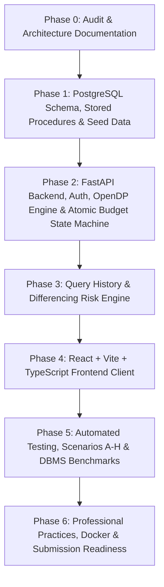

# PrivacyVault — Phased Implementation & Engineering Roadmap

**Document Version:** 1.0.0  
**Project:** PrivacyVault — An Explainable, Privacy-Preserving Database Analytics Gateway  
**Authors:** Student `24BCE0846` & `24BCE0870` (BCSE302P L25+L26)  

---

## Phase Overview & Dependency Graph

---

## Detailed Phase Breakdown & Exit Criteria

### Phase 0: Workspace Audit, Environment & Design Foundations
- **Tasks:**
  1. Inspect environment (Python 3.12, Node.js, Docker, PostgreSQL).
  2. Empirically verify differential privacy libraries (`opendp` 0.16.0 verified, `diffprivlib` deprecated conflict documented).
  3. Analyze DBMS Assessment Question Paper rubric (BCSE302P, 30+3 marks).
  4. Author foundational engineering documents: `PROJECT_AUDIT.md`, `REQUIREMENTS.md`, `ARCHITECTURE.md`, `THREAT_MODEL.md`, `IMPLEMENTATION_PLAN.md`, `DECISIONS.md`, `PROGRESS.md`.
- **Exit Criteria:** All 7 core docs completed, git initialized on `main` branch with comprehensive `.gitignore`.

### Phase 1: PostgreSQL Database Design & Implementation (Rubric: 11 Marks)
- **Tasks:**
  1. Design 3NF normalized relational schema (10+ tables):
     - `users`, `roles`, `user_roles` (Single Users table requirement)
     - `datasets`, `dataset_columns`, `dataset_grants`, `privacy_policies`
     - `privacy_budgets`, `privacy_budget_ledger`
     - `query_requests`, `query_releases`, `audit_events`
     - `protected_patients` (Synthetic clinical research dataset: 10,000+ records)
  2. Implement PostgreSQL Stored Procedure:
     - `fn_reserve_privacy_budget()`: Atomic row-level lock (`FOR UPDATE`), balance validation, ledger insertion.
     - `fn_refund_privacy_budget()`: Compensating ledger transaction for query execution failure.
  3. Implement PostgreSQL Triggers:
     - `tr_enforce_append_only_ledger()`: Enforces ledger immutability (`BEFORE UPDATE OR DELETE`).
     - `tr_sync_privacy_budget_balance()`: Verifies ledger consistency against budget state.
  4. Implement Analytical Database Views:
     - `v_dataset_metadata_catalog`: Schema exploration view hiding raw record counts.
     - `v_analyst_budget_summary`: Aggregated grant and budget expenditure metrics.
  5. Setup Alembic migrations for repeatable fresh database initialization.
  6. Create synthetic data generator in `database/seed/` with student identifiers embedded in sample data.
- **Exit Criteria:** Clean schema migrations run without errors, tables normalized to 3NF, stored procedure and trigger pass SQL unit tests.

### Phase 2: Core Backend Gateway & Differential Privacy (Rubric: 12 Marks)
- **Tasks:**
  1. Scaffold FastAPI application structure in `backend/app/`.
  2. Implement JWT authentication with `bcrypt` password hashing and RBAC middleware.
  3. Implement typed Pydantic v2 schemas for datasets, policies, and query specifications.
  4. Implement OpenDP 0.16.0 Differential Privacy Engine:
     - Contribution bounding clamp $[L, U]$ at data processing layer.
     - Pure $\epsilon$-Laplace mechanism (`make_laplace` with `AtomDomain` and `AbsoluteDistance`).
     - Gaussian mechanism for $(\epsilon, \delta)$-DP.
     - Release metadata generation.
  5. Implement Query Processing State Machine:
     `RECEIVED -> VALIDATED -> RESERVED -> EXECUTING -> RELEASED`
  6. Enforce zero raw-SQL injection via SQLAlchemy 2.0 select constructors.
- **Exit Criteria:** Gateway endpoints pass API unit tests; valid queries receive calibrated DP noise; unauthorized queries rejected.

### Phase 3: Query-History-Aware Risk Analysis Engine (Novelty Feature)
- **Tasks:**
  1. Implement historical query release indexing: store query predicate bounds and released target columns.
  2. Implement Differencing Attack Detector:
     - Evaluates symmetric difference in record sets between candidate query $Q_{new}$ and prior queries $\{Q_1, \dots, Q_k\}$.
     - Detects single-record differential reconstruction risks.
  3. Implement Repetition & Noise-Averaging Detector:
     - Tracks repeated identical queries within short time windows.
  4. Implement Explainable Recommendation Generator:
     - Generates structured risk explanations, warning severity (`LOW`, `MEDIUM`, `HIGH`, `CRITICAL`), and suggestions.
  5. Connect Risk Engine to the Query Processing pipeline before the `RESERVED` state.
- **Exit Criteria:** Differencing test case triggers `CRITICAL` risk and halts query prior to budget reservation or private data query.

### Phase 4: Frontend Web Application (React + Vite + TypeScript) (Rubric: 4 Marks)
- **Tasks:**
  1. Scaffold modern Vite React TypeScript application in `frontend/`.
  2. Implement sleek, responsive dark theme with accessible contrast and glassmorphism.
  3. Views:
     - Login & Account Profile with role indicators.
     - Analyst Dashboard: Dataset catalog, interactive Query Builder, Privacy Budget Gauge, Live Results with noise badges.
     - Query History Risk Monitor: Visual representation of differencing warnings and explanations.
     - Data Owner Portal: Dataset registration, policy tuning ($\epsilon$ caps), grant issuance.
     - Auditor Console: Filterable audit event viewer, immutable budget ledger table.
- **Exit Criteria:** Full frontend builds cleanly (`npm run build`), connects to real FastAPI endpoints without mock fallbacks.

### Phase 5: Verification, Scenarios A-H & DBMS Evaluation (Rubric: 8 Marks)
- **Tasks:**
  1. Build comprehensive automated test suite with `pytest`:
     - Schema integrity, foreign keys, triggers, stored procedures.
     - Concurrent budget overspending race condition tests.
     - SQL injection immunity tests.
     - Role-based authorization and expired grant rejection.
  2. Implement Demonstration Script (`scripts/run_demo_scenarios.py`) executing Scenarios A through H:
     - Scenario A: Ordinary aggregate with DP release.
     - Scenario B: Direct access denial.
     - Scenario C: Differencing risk detection.
     - Scenario D: Budget exhaustion denial.
     - Scenario E: Concurrent overspending prevention.
     - Scenario F: Grant expiration and revocation.
     - Scenario G: Failure recovery and compensating refund.
     - Scenario H: Complete audit inspection.
  3. DBMS Performance Evaluation:
     - Execute `EXPLAIN ANALYZE` on indexed vs unindexed analytical queries on 10,000+ patient records.
     - Record real latency and throughput metrics in `docs/BENCHMARKS.md`.
- **Exit Criteria:** 100% of critical tests pass, all 8 demo scenarios execute reproducibly against PostgreSQL.

### Phase 6: Packaging, Docker & Submission Readiness (Rubric: 5+3 Marks)
- **Tasks:**
  1. Author `docker-compose.yml` orchestrating PostgreSQL, FastAPI backend, and Vite frontend.
  2. Author PostgreSQL native backup and restore scripts (`database/scripts/backup.ps1` and `restore.ps1`).
  3. Create GitHub Actions CI workflow in `.github/workflows/ci.yml`.
  4. Write comprehensive `README.md` with setup instructions, architecture diagrams, and submission rubric mapping.
  5. Verify submission checklist (`docs/SUBMISSION_CHECKLIST.md`).
- **Exit Criteria:** Entire project launches with a single command; clean audit; zero plaintext credentials.
