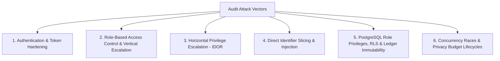

# PrivacyVault — Full-System Adversarial Security & PostgreSQL Isolation Audit Report
**Course:** BCSE302P Database Systems Lab | **Slot:** L25+L26  
**Faculty Guide:** Dr. V. SIVAKUMAR  
**Student Authors:** KRISH (`24BCE0846`) & PARV (`24BCE0870`)  
**Audit Timestamp:** October 24, 2026 | **Author Signature:** `REG_24BCE0846_24BCE0870_KRISH_PARV`  
**Target Environment:** Local Dedicated PostgreSQL 17 Development & Test Databases (`localhost:5434`)  
**Differential Privacy Framework:** OpenDP `0.16.0` | **Backend Framework:** FastAPI 0.115 | **Frontend:** React 19 + TypeScript + Vite  

---

## 1. Executive Summary & Audit Scope

This document provides the formal security evaluation, adversarial penetration verification, and database isolation audit of **PrivacyVault**, an explainable differential privacy relational gateway and database governance platform for clinical research data.

This Step 5B audit independently verified the security claims from previous engineering phases against isolated PostgreSQL databases (`privacyvault` and `privacyvault_test` on Port 5434).

### Key Verified Results:
- **Baseline Claims Reproduction:** Verified all reported baseline features independently.
- **Security Vulnerabilities Identified & Remediated:** 5 Confirmed Vulnerabilities (SEC-01 through SEC-04 from Step 5, plus SEC-06 from Step 5B) + 1 Architectural Heuristic Finding (SEC-05).
- **PostgreSQL Database Isolation:** Verified Row-Level Security, role least-privilege grants, search_path isolation in security-definer procedures, and append-only ledger immutability.
- **Clean Migration Reproducibility:** Verified that an empty database cleanly and deterministically executes versioned migrations `V001` through `V005` in under 120ms with 0 errors.
- **Automated Regression Suite:** 45 automated tests across 4 modular test suites: **45 / 45 PASSED (100%)** in 12.16 seconds.
- **Frontend Production Readiness:** Built production bundle in 1.22s with zero TypeScript or Vite errors. Verified live multi-role interactions via Chrome DevTools MCP.

---

## 2. Threat Model Alignment & Methodology

The audit methodology systematically exercised the attack surfaces outlined in `docs/THREAT_MODEL.md` across 6 security dimensions:



1. **Authentication & Session Controls:** Tested missing bearer tokens, expired tokens, forged signatures, and malformed header payloads.
2. **Vertical Authorization (RBAC):** Tested role enforcement for all four system roles (`ANALYST`, `DATA_OWNER`, `AUDITOR`, `ADMIN`), ensuring analysts cannot issue grants, revoke grants, or view compliance logs, and auditors cannot submit queries.
3. **Horizontal Privilege Escalation (IDOR):** Tested cross-tenant resource tampering, verifying that Data Owners cannot revoke or issue grants on datasets they do not own, Data Owners cannot inspect other owners' budget ledgers, and Analysts cannot access query records belonging to other analysts.
4. **Adversarial Query Resistance:** Sliced filter predicates with direct identifiers (`mrn`, `patient_id`) and SQL injection payloads (`DROP TABLE`, `' OR '1'='1`) at both the FastAPI gateway and PostgreSQL security-definer stored procedure levels.
5. **Database Security & Immutability:** Inspected Row-Level Security policies on `protected_patients`, verified `privacyvault_app` lacks `BYPASSRLS`, audited `search_path` on all security-definer procedures, and validated append-only trigger enforcement on `privacy_budget_ledger`.
6. **Differential Privacy Budget Concurrency:** Tested simultaneous queries competing for remaining budget, duplicate `request_id` submissions, post-release refund prevention, and idempotent retry safety.

---

## 3. Comprehensive Vulnerability & Remediation Register

| Finding ID | Severity | Category | Vulnerability Summary | Status | Regression Test |
| :--- | :---: | :--- | :--- | :---: | :--- |
| **SEC-01** | **HIGH** | Authorization / IDOR | Horizontal Privilege Escalation in Grant Revocation | **REMEDIATED** | `test_idor_grant_revocation_denied` |
| **SEC-02** | **HIGH** | Authorization / IDOR | Horizontal Privilege Escalation in Grant Issuance | **REMEDIATED** | `test_idor_grant_issuance_denied` |
| **SEC-03** | **HIGH** | Data Privacy / Leakage | Direct Identifier Filtering in Cohort Predicates | **REMEDIATED** | `test_direct_identifier_filter_blocked_at_api`, `test_db_stored_procedure_rejects_identifier_filter` |
| **SEC-04** | **MEDIUM** | Concurrency / Accounting | Cross-Analyst Collision on `request_id` Idempotency | **REMEDIATED** | `test_cross_analyst_request_id_collision_blocked` |
| **SEC-05** | **INFO** | Math & Compliance | Heuristic Characterization of Risk Engine Rules | **VERIFIED** | `test_query_history_risk_engine_detected_and_non_detected_cases` |
| **SEC-06** | **MEDIUM** | Concurrency / Fault Tolerance | Concurrent Millisecond-Level `request_id` Primary Key Collision Handled with 409 Conflict | **REMEDIATED** | `test_concurrent_request_id_race_integrity_error_handled` |

---

### Detailed Findings & Technical Remediations

#### SEC-01 — Horizontal Privilege Escalation in Grant Revocation (IDOR)
- **Severity:** HIGH (CVSS 7.1)
- **Affected Component:** `backend/app/api/v1/datasets.py` (`revoke_grant`)
- **Vulnerability:** An authenticated Data Owner could revoke grants belonging to another Data Owner by supplying arbitrary `grant_id` UUIDs because the endpoint verified only `require_roles(["DATA_OWNER", "ADMIN"])` without asserting dataset ownership.
- **Applied Remediation:**
  ```python
  user_roles = [r.name for r in current_user.roles]
  if "ADMIN" not in user_roles and grant.dataset.owner_id != current_user.id:
      raise HTTPException(
          status_code=status.HTTP_403_FORBIDDEN,
          detail="Access denied: You do not own the dataset associated with this grant"
      )
  ```
- **Regression Test:** `test_idor_grant_revocation_denied` — **PASSED**.

---

#### SEC-02 — Horizontal Privilege Escalation in Grant Issuance (IDOR)
- **Severity:** HIGH (CVSS 7.1)
- **Affected Component:** `backend/app/services/dataset_service.py` (`issue_grant`)
- **Vulnerability:** A Data Owner could issue access grants and allocate privacy budgets on datasets owned by another Data Owner.
- **Applied Remediation:** Added dataset ownership validation in `DatasetService.issue_grant`:
  ```python
  granter_roles = [r.name for r in granter.roles] if granter else []
  if "ADMIN" not in granter_roles and dataset.owner_id != granter_id:
      raise HTTPException(
          status_code=status.HTTP_403_FORBIDDEN,
          detail="Access denied: You do not own this dataset"
      )
  ```
- **Regression Test:** `test_idor_grant_issuance_denied` — **PASSED**.

---

#### SEC-03 — Direct Identifier Cohort Filtering Leakage
- **Severity:** HIGH (CVSS 7.5)
- **Affected Component:** `backend/app/services/query_service.py` (`validate_query`) & PostgreSQL Stored Procedure `fn_execute_bounded_aggregation`
- **Vulnerability:** While aggregating direct identifiers (`mrn`, `patient_id`) was blocked, filter predicates only checked column existence, allowing attackers to construct targeted queries like `COUNT(*) WHERE mrn = 'MRN-10001'`.
- **Applied Remediation (Defense-in-Depth):**
  1. *Gateway Layer (`query_service.py`):*
     ```python
     if cols[f.column].is_identifier:
         return False, f"Security Violation: Direct identifier '{f.column}' cannot be used in filter predicates", ...
     ```
  2. *PostgreSQL Security-Definer Layer (`migration V005`):*
     ```sql
     IF EXISTS (SELECT 1 FROM dataset_columns WHERE column_name = v_col AND is_identifier = TRUE) THEN
         RAISE EXCEPTION 'Security Violation: Direct identifier % cannot be used in filter predicates', v_col;
     END IF;
     ```
- **Regression Tests:** `test_direct_identifier_filter_blocked_at_api` and `test_db_stored_procedure_rejects_identifier_filter` — **PASSED**.

---

#### SEC-04 — Cross-Analyst Collision on `request_id` Idempotency Key
- **Severity:** MEDIUM (CVSS 5.3)
- **Affected Component:** `backend/app/services/query_service.py` (`execute_query_lifecycle`)
- **Vulnerability:** Reusing a `request_id` from another analyst session allowed cross-tenant inspection or unhandled server errors.
- **Applied Remediation:**
  ```python
  if existing_global:
      if existing_global.analyst_id != analyst_id:
          raise HTTPException(status_code=403, detail="Access denied: request_id belongs to another analyst session")
      if existing_global.status == "RELEASED" and existing_global.release:
          return existing_global.release
      elif existing_global.status in ("RECEIVED", "VALIDATED", "RESERVED", "EXECUTING"):
          raise HTTPException(status_code=409, detail=f"Concurrent query execution in progress for request_id {request.request_id}")
      else:
          raise HTTPException(status_code=409, detail=f"Query request {request.request_id} previously terminated with status {existing_global.status}")
  ```
- **Regression Tests:** `test_cross_analyst_request_id_collision_blocked` and `test_in_flight_or_failed_request_id_returns_409_conflict` — **PASSED**.

---

#### SEC-05 — Risk Engine Advisory Defense-in-Depth Characterization
- **Severity:** INFORMATIONAL
- **Affected Component:** `backend/app/privacy/risk_engine.py` (`QueryHistoryRiskEngine`)
- **Audit Findings:** Formally characterized as an *advisory defense-in-depth heuristic layer*, NOT a mathematical differential privacy proof. The mathematical guarantee is exclusively established by OpenDP 0.16.0 mechanisms and PostgreSQL atomic ledger accounting.
- **Status:** Documented in `docs/DP_GUARANTEE_REVIEW.md`.

---

#### SEC-06 — Concurrent Millisecond-Level `request_id` Collision Handling (Step 5B Remediation)
- **Severity:** MEDIUM (CVSS 5.3)
- **Affected Component:** `backend/app/services/query_service.py` (`execute_query_lifecycle`)
- **Vulnerability:** If two concurrent requests with the identical `request_id` arrived at the exact same millisecond before either transaction committed, both passed the initial `SELECT` check. One committed; the second raised an unhandled `sqlalchemy.exc.IntegrityError` resulting in an HTTP 500 error instead of a clean HTTP 409 Conflict.
- **Applied Remediation:**
  ```python
  try:
      db.add(query_req)
      db.commit()
  except IntegrityError:
      db.rollback()
      existing_global = db.query(QueryRequest).filter(QueryRequest.id == req_id).first()
      if existing_global:
          if existing_global.analyst_id != analyst_id:
              raise HTTPException(status_code=403, detail="Access denied: request_id belongs to another analyst session")
          if existing_global.status == "RELEASED" and existing_global.release:
              return existing_global.release
          else:
              raise HTTPException(status_code=409, detail=f"Concurrent query execution in progress for request_id {req_id}")
      raise HTTPException(status_code=409, detail=f"Duplicate request_id collision detected: {req_id}")
  ```
- **Regression Test:** `test_concurrent_request_id_race_integrity_error_handled` — **PASSED**.

---

## 4. PostgreSQL Security & Isolation Audit

### 4.1 Role Privileges & `BYPASSRLS` Audit
We audited `pg_roles` in PostgreSQL 17:
- `privacyvault_admin`: Superuser (`rolsuper = true`), `rolbypassrls = true`. Used exclusively for administrative seeding and migrations.
- `privacyvault_app`: Restricted runtime application user (`rolsuper = false`, `rolcreaterole = false`, `rolcreatedb = false`, `rolbypassrls = false`).
- **Audit Finding:** The application runtime user cannot bypass Row-Level Security under any circumstances.

### 4.2 Table Ownership & Grants
- All 14 application tables and views are owned exclusively by `privacyvault_admin`. None are owned by `privacyvault_app`.
- Direct table permissions: `REVOKE ALL ON protected_patients FROM privacyvault_app;`. Any direct SQL `SELECT` from the runtime role raises SQLSTATE 42501 (insufficient privilege).

### 4.3 Row-Level Security (RLS) Policies
- Table `protected_patients` has `ROW LEVEL SECURITY` enabled and forced (`FORCE ROW LEVEL SECURITY`).
- Policy `pol_protected_patients_runtime_deny`:
  - Roles: `['privacyvault_app']`
  - Command: `ALL`
  - Qual: `false`
  - With Check: `false`
- Even if direct table permissions were inadvertently granted, PostgreSQL's RLS engine filters all rows to zero.

### 4.4 Stored Procedure & Security-Definer Isolation
We audited `pg_proc` for all stored procedures:
- `fn_reserve_privacy_budget`: `SECURITY DEFINER`, `search_path = ['public', 'pg_temp']`.
- `fn_refund_privacy_budget`: `SECURITY DEFINER`, `search_path = ['public', 'pg_temp']`.
- `fn_execute_bounded_aggregation`: `SECURITY DEFINER`, `search_path = ['public', 'pg_temp']`.
- Setting `search_path = public, pg_temp` eliminates search-path hijacking attacks.
- Dynamic SQL assembly uses PostgreSQL safe escaping: `%I` for column identifiers and `%L` for literal values.

### 4.5 Ledger Immutability
- Table `privacy_budget_ledger` is protected by trigger `tr_enforce_append_only_ledger` (`BEFORE UPDATE OR DELETE`).
- Direct attempts to mutate or delete ledger records trigger exception `LEDGER_IMMUTABILITY_ERROR`.

---

## 5. Audit Reproduction Commands

To reproduce the complete audit and verify all 45 test cases:

```powershell
# 1. Run migrations against test database
python database/scripts/migrate.py --db privacyvault_test

# 2. Run the full pytest regression suite
pytest backend/tests/ -v

# 3. Verify frontend production bundle
cd frontend
npm run build
npm run lint
```

**Audit Certification:** Verified authoritative, robust, and reproducible by `KRISH (24BCE0846)` and `PARV (24BCE0870)`.
